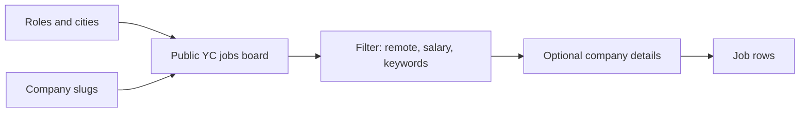

# Y Combinator Jobs Scraper: YC Startup Jobs with Salary and Equity

[](https://apify.com/Turboextract/yc-startup-jobs)
[](LICENSE)
[](#pricing)

**Export jobs at Y Combinator startups with salary range, equity, location, visa, experience and company batch.** Filter by role, city, remote, company and keyword, and optionally add each company's website, team size and description. Reads the public YC jobs board, so there is no login.

In one test, the software engineer page returned 36 jobs in seconds, with salaries like $265K and equity like 0.12%, plus the website and team size for every company.

**Try it now →** [apify.com/Turboextract/yc-startup-jobs](https://apify.com/Turboextract/yc-startup-jobs)

---

## Why this exists

- The YC jobs board shows jobs one role and city at a time, with no export.
- Salary, equity and visa details are only on each listing.
- Recruiting and sales teams need the company website and size next to each job.
- Startup job data APIs charge monthly.

---

## Who this is for

- **Job seekers** who want every YC engineering, design or sales job in one sheet
- **Recruiters and staffing agencies** looking for funded startups that are hiring
- **Sales teams** selling HR, payroll, dev tools or office services to young startups
- **Investors and analysts** tracking which YC companies are growing
- **Job boards** adding startup roles with salary data

---

## What you get

```json
{
  "jobId": 63615,
  "title": "Systems Engineer [In Person, SF]",
  "jobUrl": "https://www.ycombinator.com/companies/recall-ai/jobs/B8CE5Xc-systems-engineer-in-person-sf",
  "company": "Recall.ai",
  "batch": "W20",
  "oneLiner": "The API to get recordings, transcripts, and metadata from meetings",
  "role": "Engineering",
  "roleType": "Backend",
  "location": "San Francisco, CA, US / Remote",
  "remote": true,
  "salaryRange": "$265K",
  "salaryMinK": 265,
  "salaryMaxK": 265,
  "salaryCurrency": "USD",
  "equityRange": "0.12%",
  "minExperience": "3+ years",
  "visa": "Will sponsor",
  "companyWebsite": "https://www.recall.ai",
  "teamSize": 30
}
```

---

## How it works



---

## Quick start

1. Click **Try for free**.
2. Pick **Roles**, like Software Engineer or Sales, and optionally **Locations**.
3. Or add **Companies**, like `numeral`, to get every open job at those startups.
4. Optional: **Remote only**, **Minimum salary** or **Keywords**.
5. Click **Start**, then export to CSV, JSON or Google Sheets.

### API

```bash
curl -X POST "https://api.apify.com/v2/acts/Turboextract~yc-startup-jobs/run-sync-get-dataset-items?token=YOUR_TOKEN" \
  -H "Content-Type: application/json" \
  -d '{"roles": ["software-engineer"], "locations": ["remote"], "minSalaryK": 150}'
```

### Python

```python
from apify_client import ApifyClient

client = ApifyClient("YOUR_TOKEN")
run = client.actor("Turboextract/yc-startup-jobs").call(run_input={
    "roles": ["sales-manager", "marketing"],
    "includeCompanyDetails": True,
})
for job in client.dataset(run["defaultDatasetId"]).iterate_items():
    print(job["company"], job["batch"], job["title"], job["salaryRange"])
```

---

## Input fields

| Field | Default | What it does |
|---|---|---|
| `roles` | – | Engineering, design, product, recruiting, sales, marketing, support, operations, science |
| `locations` | all | Remote, San Francisco, New York, Los Angeles, Seattle, Boston, Austin, Chicago, India |
| `companies` | – | YC company slugs or URLs |
| `keywords` | – | Match title, skills, company or one-liner |
| `remoteOnly` | false | Only remote jobs |
| `minSalaryK` | 0 | Top of salary range in thousands of US dollars |
| `includeCompanyDetails` | false | Website, team size, location, description |
| `maxResults` | 200 | Total cap per run |

---

## Pricing

**$0.003 per job delivered.** 1,000 jobs cost $3.

| Option | 1,000 jobs |
|---|---|
| **YC Jobs Scraper** | **$3**, salary, equity and company details included |
| Other YC jobs actors on Apify | Monthly rental or higher per-result prices |
| Startup job data APIs | $100+ a month |

---

## Common use cases

- **Job hunting**: every remote YC engineering job above $150K
- **Recruiting leads**: startups hiring 3+ roles, with website and team size
- **Sales prospecting**: newly funded teams hiring sales or ops, ready for your tool
- **Salary research**: pay and equity ranges by role and city
- **Hiring signals**: run daily and track which YC companies add roles
- **Batch tracking**: which recent YC batches are hiring the most

---

## Tips for best results

- Roles and locations combine, so Software Engineer + Remote reads one page.
- Pass company slugs from [YC Company Leads](https://apify.com/Turboextract/yc-company-leads) to get each company's full job list.
- Dedupe on `jobId` across scheduled runs.
- `postedAgo` is YC's own label, like "3 months".
- Salaries outside the US keep their own currency, shown in `salaryCurrency`.

---

## Pairs well with

- [YC Company Leads](https://apify.com/Turboextract/yc-company-leads): every YC company with founders and LinkedIn
- [ATS Job Feed](https://apify.com/Turboextract/ats-job-feed): jobs from Greenhouse, Lever, Ashby, Workable and SmartRecruiters
- [HN Hiring Leads](https://apify.com/Turboextract/hn-hiring-leads): companies hiring in Hacker News threads

---

## FAQ

**Do I need a Work at a Startup account?** No. The actor reads the public jobs pages on ycombinator.com.

**Can I apply through the actor?** No. Each row has the job link, and you apply on YC's site.

**Why do some jobs have no salary?** The company left it blank. Set `minSalaryK` to 0 to keep them.

**How fresh is the data?** It is read live on every run.

**Is it legal?** It reads public job listings that YC publishes for anyone to see.

---

## SEO keywords

YC jobs scraper, Y Combinator jobs, Work at a Startup scraper, startup jobs API, YC startup jobs export, startup salary data, remote startup jobs, startup hiring leads, YC company jobs, tech jobs scraper

---

## Support

- Actor page: https://apify.com/Turboextract/yc-startup-jobs
- Issues and questions: open an issue in this repo
- Community Discord: https://discord.gg/8SrXSCpvgj

Built and maintained by [Turboextract](https://apify.com/Turboextract) on the Apify platform.

---

## License

The documentation and examples in this repository are MIT licensed. The actor itself runs on the Apify platform.
